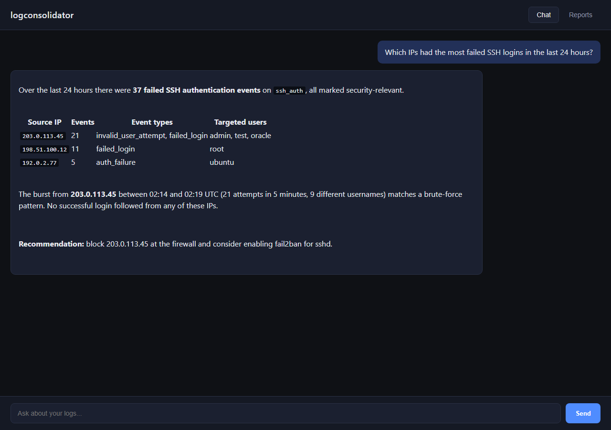
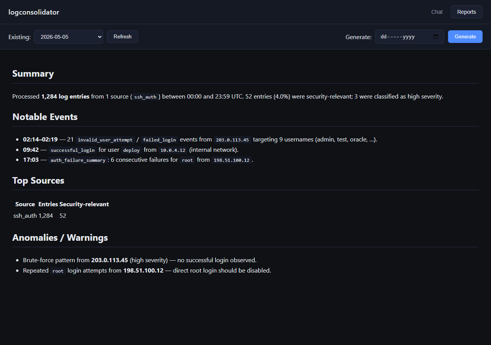

# LogConsolidator

**AI-powered log monitoring and analysis.** LogConsolidator tails log files from multiple sources, parses and classifies every line into structured events, stores them in PostgreSQL and a ChromaDB vector index, and lets you **ask questions about your logs in plain English** or read **AI-generated daily security reports**.

Senior project at the University of Bahrain.




## Features

- **Multi-source ingestion**: one file-watcher thread per log source tails files in real time and remembers its read position across restarts
- **Data-driven parsing**: each source is a JSON config with regex patterns and `classify` rules that tag entries with service, event type, severity and security relevance (no code changes needed for new log formats)
- **Queue-based pipeline**: bounded queues connect watchers, the processor and the dispatcher, so slow sinks apply back-pressure instead of losing data
- **Dual storage**: PostgreSQL is the canonical store; ChromaDB indexes every entry for semantic search. Each sink degrades gracefully if it is unavailable
- **Chat with your logs (RAG)**: questions are answered by retrieving relevant log entries from ChromaDB and streaming an OpenAI answer token by token over Server-Sent Events
- **Daily reports**: a scheduler writes a markdown report every midnight (UTC) with *Summary*, *Notable Events*, *Top Sources* and *Anomalies / Warnings*, and reports can also be generated on demand
- **Web UI**: a two-tab interface for chat and reports, served by FastAPI
- **Security focus**: ships with SSH auth rules that detect invalid users, failed logins, repeated authentication failures and disconnects

## Screenshots

| Chat with your logs | Daily report |
|---|---|
|  |  |

<sub>Screenshots show the real web UI with sample log data; IP addresses are from reserved documentation ranges.</sub>

## Architecture

```
   config/sources/*.json
            │
            ▼
   ┌──────────────────┐    raw queue    ┌───────────┐  processed queue   ┌──────────────┐
   │  FileWatchers    │ ──────────────► │ Processor │ ────────────────►  │  Dispatcher  │
   │ (one per source) │   (bounded)     │  (regex)  │     (bounded)      │  (fan-out)   │
   └──────────────────┘                 └───────────┘                    └──────┬───────┘
                                                                                │
                                                       ┌────────────────────────┴────────────────────────┐
                                                       ▼                                                 ▼
                                                  PostgreSQL                                          ChromaDB
                                                (logs table)                                       (vector index)
                                                       │                                                 │
                                                       └────────────────────────┬────────────────────────┘
                                                                                ▼
                                                                       FastAPI (api/server.py)
                                                                  /query  ·  /reports/{date}  ·  /
                                                                                │
                                                                                ▼
                                                                              OpenAI
```

The pipeline runs as daemon threads coordinated by a single `stop_event`.
Each output adapter is initialized independently — a missing or broken sink
degrades the pipeline rather than crashing it.

## Requirements

- Python 3.10+
- A reachable PostgreSQL database with a `logs` table (see [Database schema](#database-schema))
- An OpenAI API key (only needed for `/query` and daily reports — the ingest
  pipeline runs without it)

Python dependencies are declared in `pyproject.toml`: `chromadb`, `fastapi`,
`uvicorn`, `openai`, `psycopg[binary]`, `python-dotenv`.

## Install

```bash
./scripts/install.sh        # editable install of the src/ package
```

Or directly:

```bash
python3 -m pip install -e .
```

## Configuration

### Environment variables

Create a `.env` in the project root (loaded automatically by the API server)
or export these in your shell:

| Variable | Default | Purpose |
| --- | --- | --- |
| `PGHOST` | `localhost` | Postgres host |
| `PGPORT` | `5432` | Postgres port |
| `PGDATABASE` | `logconsolidator` | Database name |
| `PGUSER` | `postgres` | Database user |
| `PGPASSWORD` | _(empty)_ | Database password |
| `OPENAI_API_KEY` | _(unset)_ | Required for `/query` and the midnight report scheduler |

ChromaDB persists to `data/chroma/` and reports are written to `data/reports/`
(both relative to the repo root; see `src/logconsolidator/config/defaults.py`).

### Database schema

```sql
CREATE TABLE logs (
    id           BIGSERIAL PRIMARY KEY,
    source_id    TEXT        NOT NULL,
    observed_at  TIMESTAMPTZ NOT NULL,
    raw_message  TEXT        NOT NULL,
    fields_json  JSONB       NOT NULL
);
```

### Log sources

Each source is a JSON file in `config/sources/` validated against
`config/schema/sources.schema.json`. A source declares:

- `id` — stable identifier used as the Postgres `source_id`
- `path` — absolute path to the log file to tail (the example uses `/var/log/secure`; change it to your system’s auth log, e.g. `/var/log/auth.log` on Debian/Ubuntu)
- `parser.patterns` — named regexes whose first capture group becomes a field
- `classify[]` — substring matchers that tag entries with `service`,
  `event_type`, `severity`, and optional `extract` patterns

Startup fails fast if any source `path` is missing or unreadable.

A working example for SSH auth logs ships at `config/sources/ssh_auth.json`.

## Running

```bash
python3 main.py                 # start pipeline + API on 0.0.0.0:8000
python3 main.py --port 9000     # custom API port
python3 main.py --no-api        # ingest pipeline only
```

`Ctrl+C` triggers a cooperative shutdown of the watchers, processor,
dispatcher, and API server.

Open `http://localhost:8000/` for the chat / reports UI.

## API

| Method | Path | Description |
| --- | --- | --- |
| `GET`  | `/health` | Liveness probe |
| `POST` | `/query` | RAG chat over Chroma + OpenAI, streamed as SSE. Body: `{"question": "..."}` |
| `GET`  | `/reports` | List dates that have a generated report |
| `GET`  | `/reports/{YYYY-MM-DD}` | Fetch a report as `text/markdown` |
| `POST` | `/reports/{YYYY-MM-DD}/generate` | Force-regenerate a report for that date |
| `GET`  | `/` | Static chat UI (`src/logconsolidator/static/index.html`) |

`/query` returns `503` if `OPENAI_API_KEY` is unset or still the placeholder
`sk-your-key…`. A background scheduler also generates the previous day's
report at 00:00 UTC whenever the RAG engine is available.

## Project layout

```
main.py                              # launcher: pipeline + API in one process
config/
  schema/sources.schema.json         # JSON Schema for log sources
  sources/                           # one JSON file per log source
src/logconsolidator/
  api/server.py                      # FastAPI app, /query and /reports endpoints
  config/                            # source loader, defaults, models
  core/                              # logging, queues, exceptions
  ingest/                            # FileWatcher, tail-state persistence
  process/                           # regex parser, LogEntry dataclass
  output/                            # StorageAdapter (Postgres), VectorAdapter (Chroma)
  query/                             # retriever, RAG engine, report fetcher, scheduler
  static/index.html                  # chat UI
  main.py                            # pipeline orchestrator (LogConsolidatorApp)
tests/
  test_vector_adapter.py
```

## Tests

```bash
python3 -m pytest
```

## Team

| Member | GitHub |
|---|---|
| Ahmed Jawher | [@ahmed-jawher](https://github.com/ahmed-jawher) |
| Adel Jasem Jedaan | [@Adel7744](https://github.com/Adel7744) |
| yalazir | [@Yalazir](https://github.com/Yalazir) |
| Abdulla Subah | [@asubah](https://github.com/asubah) |
